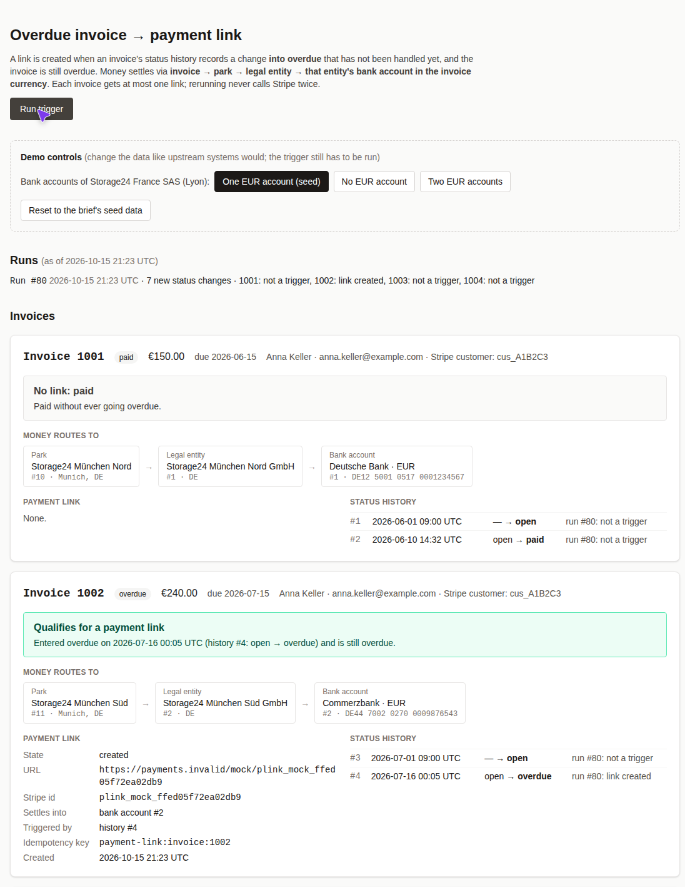
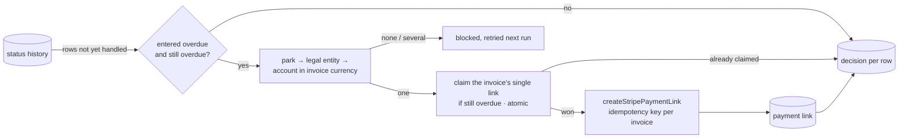

# payment-trigger

When an invoice's status history records a change **into overdue**, create one
Stripe payment link (mocked) that settles into the **right legal entity's bank
account**, and show why each invoice did or didn't trigger.

**Live demo:** https://payment-trigger-app-demo-ozchigf3lz6tg4ix.julian-93527c9983d1.workers.dev

Click **Run trigger**: 1002 gets a link to Süd GmbH / Commerzbank (account 2). Click
it again and nothing new happens. The demo controls simulate 1003 going overdue, a
broken bank-account setup, and a reset.



## How it works



- **Core logic is pure and lives in [`packages/domain`](packages/domain/src):**
  `Trigger.ts` decides whether an invoice triggers, `Routing.ts` finds the bank
  account and builds the exact stub input.
- **Run bookkeeping is in [`apps/api/src`](apps/api/src):** `TriggerRun.ts` and
  `TriggerStore.ts`. Every guarantee is a single atomic SQL statement, because D1 has
  no transactions. The Stripe stub (`StripePaymentLinks.ts`) logs every call, and the
  UI shows those inputs.
- **UI:** [`apps/web`](apps/web/src), React + Tailwind, data through Effect's
  `AtomHttpApi` and the shared API contract.

**Why a Worker and a database instead of static JSON:** "rerunning must not
duplicate" needs state that outlives a browser tab, and the trigger is a backend job,
not page logic (assumption 11).

## Docs

- [Assumptions](docs/assumptions.md) (also [PDF](docs/assumptions.pdf), in the
  brief's template): trigger choice, routing, what the Stripe docs say.
- [Design note](docs/design-note.md): the Stripe webhook → status trigger and the
  receipt trigger.
- [What I'd do next](docs/next-steps.md), from a self-review with measured findings.

## Run it

```sh
bun install
bun run check   # format, lint, strict typecheck
bun run test    # 41 tests: domain, plus the run service on real SQLite migrations
E2E_BASE_URL=<url> bun run e2e   # Playwright against a deployed stage
```

The stack is Bun workspaces, TypeScript strict, and Effect v4 (Schema, HttpApi, SQL),
on one Cloudflare Worker (API and static assets) with D1, deployed with Alchemy.

CI (`.github/workflows`) runs the checks on every push. On `main` it then deploys the
`demo` stage and runs Playwright against it.

The GitHub repository and the Cloudflare/Alchemy credentials (repository secrets)
were set up before this session; everything else was built in it.
