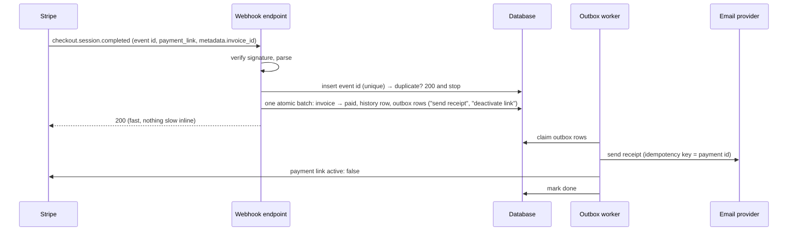

## Design note: the two non-implemented triggers

Both hang off one event: Stripe telling us money arrived. So the webhook is built
first, and the receipt is a consequence of the status change it records.

### 1. Stripe webhook success → update invoice status

- **Trigger:** `checkout.session.completed` when the session's `payment_status` is
  `paid`, and `checkout.session.async_payment_succeeded` for delayed payment methods,
  which complete the session unpaid and settle later. Stripe recommends
  `checkout.session.completed` for Payment Links fulfilment. The invoice is found via
  the session's `payment_link` id (we store it per invoice), cross-checked against
  `metadata.invoice_id` (link metadata is copied to its sessions). Never match by
  amount or email.
- **What can go wrong, and the guard for each:**
  - **Duplicate delivery** (Stripe states it happens; it retries for up to 3 days).
    → Store `event.id` under a unique constraint and skip a repeat. Also skip if the
    invoice is already paid.
  - **Out-of-order events** (Stripe does not guarantee order). → Never let an event
    move an invoice backwards: `UPDATE … SET status='paid' WHERE id=? AND status IN
    ('open','overdue')`. A late "failed" event after "succeeded" changes nothing.
  - **Races with our own trigger** (paid while a link is being created). → The trigger
    already re-checks `overdue` inside its claim. On paid, an outbox row deactivates
    the invoice's link (`active: false`) so it can't be paid twice. Today nothing
    deactivates links: this is the top next step.
  - **Forged calls.** → Verify the `Stripe-Signature` header with the endpoint secret
    before reading anything.
  - **Slow handler → Stripe retries → more duplicates.** → Do one atomic D1 `batch()`
    (D1 has no interactive transactions; a batch is one), return 200, and push every
    external call to the outbox.
  - **Partial payments, refunds, disputes.** → Separate events
    (`charge.refunded`, `charge.dispute.created`) feeding their own status changes.
    Out of scope here, and flagged rather than ignored.
  - **Missed events** (endpoint down for more than 3 days). → A daily reconciliation
    lists the last day's paid sessions from the API and applies the same idempotent
    update.

### 2. Receipt of payment to the customer

- **Trigger:** the recorded `→ paid` history row, not the webhook directly. It's the
  same "handle each new history row once" pattern as the payment-link trigger, so a
  payment recorded by any path (webhook, bank transfer, manual) gets exactly one
  receipt.
- **What can go wrong, and the guard for each:**
  - **Double receipt** from duplicate webhooks or retried jobs. → One outbox row per
    payment, unique on the history row id. The email send uses an idempotency key
    (payment id) if the provider supports one.
  - **Receipt for money we didn't get** (async methods, a later dispute). → Send only on
    `paid`, not on `processing`. A refund sends a separate correction, never a silent
    edit.
  - **Email provider down or slow.** → Retry from the outbox with backoff. An outbox
    row is written in the same batch as the status change, so a crash cannot lose or
    duplicate it. Alert when a row stays unsent.
  - **Wrong legal entity on the receipt.** → Reuse the same routing as the link
    (invoice → park → legal entity). The receipt names the entity that received the
    money, which matters for invoices and tax.
  - **Missing or wrong email** (no Stripe customer, as for 1003's customer). → Use
    the invoice customer's email. If Stripe's automatic receipts are also switched on
    (a Dashboard setting, sent only for successful payments), the customer gets two
    receipts: pick one source.
